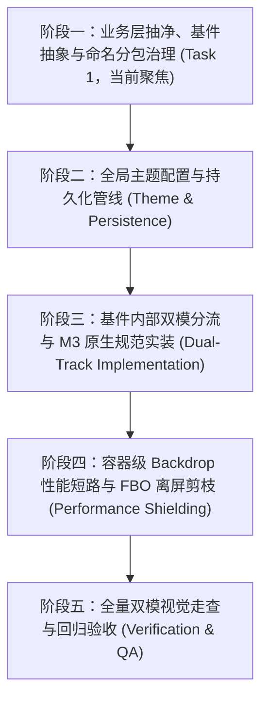

# Zafiro 主题架构重构总览：最终目标与规划路线图

> **文档性质**：工作区总览纲领文档  
> **文档位置**：`docs/theme-m3/01-OVERVIEW_AND_FINAL_GOAL.md`  
> **当前状态**：待用户审查（审查通过前不进行实际代码修改）

---

## 一、 用户完整原话记录（Unaltered & Unabridged）

以下按对话时序完整收录用户的全部原话输入，不做任何删减、缩略或摘要：

### 第 1 轮用户输入
> 调研一下我们这个项目的主题。我们项目现在的主题是 Material 3 跟 Backdrop API 混合的一个结构。现在我想明确开放一个设置，允许用户启额外启用 Backdrop，因为我们号称这个项目是 Material 3，但是现在已经完全往 Liquid Glass 这个方向去靠了。
> 
> 涉及的内容，第一个是编辑区，这个编辑区在设置页还有主页面的编辑框都有涉及。有一些组件它还涉及一个拖拽的效果，就是它可以被呃拖拽。
> 
> 第二个是弹窗，我们现在的弹窗用的也是这些效果。第三个是 action bar，这个是最严重的。我觉得你也可以 grep 一下，到底什么组件用了 backdrop。然后这个 backdrop 在一些场景下还有呃传递的需求，就是不同的层级之间他们会 share 一个 backdrop layer 来传递这种玻璃模糊的效果。
> 
> 然后这个 action bar 现在是有两个可以拖拽的按钮吗？我希望如果是开启了 material 的话，那这两个按钮它就不会有一个圆形的背景。反正你应该知道 Material Three 的 Action Bar 长什么样吧？还有就是这个 Drop Down Menu 我们自己手搓的。如果开启了 Material Three，那就应该用官方的 Drop Down Menu。我感觉这个东西改动还挺多，但是还是比较机械的。只不过可能很多地方都要，呃，把逻辑给抽一下，用一些全局开关去搞。我不知道应该怎么弄。是呃，我觉得比较好的一个处理方式是，把基件全部抽出来。做成单独的组件，那就不用在实际的 UI 业务里面再去判断有没有打开那个开关。
> 
> 总的来说，要考虑的东西有好几点。第一个是架构方面，第二个是 Material Three 到底长什么样，第三个就是我们执行的顺序应该怎么去执行。
> 
> research only

### 第 2 轮用户输入
> 那这样的话，从命名开始就得区分开来。呃，那我们统一的基建就叫做 ZafiroXXXComponent 里面再细分为，material/Liquid 而且有些组件它的命名是不准确的。如果一个组件它没用 backdrop，那就不应该叫做 liquid。如果呃没有用 backdrop，那它直接就可以命名成ZafiroXXX 
> 
> 我不太关心下层的实现是什么样，我只希望知道业务层的 UI 是怎么样的，也就是 App 模块里面的 Compose 代码。如果有必要的话，我们可以将部分逻辑下沉到 UI Kit，不然的话，主 UI 是不干净的。我还是更希望先把业务层抽干净。就算我们没有真正支持区分开 Material 3 跟 Liquid，那业务层搞干净了，后面慢慢重构也是可以的。

### 第 3 轮用户输入
> 还有就是性能啊，呃，你很多地方传了一个什么什么 backdrop layer，你应该有看到这样的 API 吧？这些 API 是会影响性能的。如果用户没有开启 liquid 主题的话，那这个东西就不应该调用。

### 第 4 轮用户输入
> 那第一步是不是一个机械迁移啊？我更在意的是分包，因为你所有的代码全部堆在一个包下面会很乱，很难看的。我们这次顺便可以治理一下这个问题。我们现在聚焦于第一个任务来看吧。

### 第 5 轮用户输入
> 呃，既然这样，我们的验收标准是什么呢？我给你举个例子，仓库里面的某个包下面不再出现什么样的字段，或者通过 pre-commit 的钩子等等，你先给我一个验收的标准吧，给我一个可以量化出你的工作结果的一个样的东西。对了，这个 backdrop 的库还挺复杂的，很容易出问题，这也是一个需要考虑的点。我其实不确定你直接通过 composition local 哪会不会有问题。如果你能确定的话，那就这样搞一下；不然的话，签名里面有行参，暂时还算是可以接受。刚好你这次可以调整一下，保证modifier这个参数放在第一个还是最后一个，我忘了。compose有个标准是把modifier放在首位还是末位的，你自己看一下吧。有些组件它是没有按照这个标准来的。我理解，这一次是处理分包以及一个机械迁移的这个逻辑，业务是不需要改的。也就是说，这次写完代码之后，我们是感知不到有任何变化的，这才对。我看你列了三个 step，那每个 step 的 LOC 大概会是多少呢？

### 第 6 轮用户输入
> 开工你觉得要分几个提交呢？因为涉及代码重构的话，我们可能很可能会命中一个 Git Hook，这个钩子会强制要求每个文件的大小不能超过某个量级，所以说可能会引入很多呃重构方面的问题。我不知道有没有办法暂时跳过。
> 
> ---
> 
> 重要事件：UI进行了大幅重构，现在先更新本分支，然后重新调研。两个文档给我保留一下。重新调研，在压缩/完成后重读文档确保不跑偏。如果大方向变化的话我们重新做调研，不然我们调整一下计划就推进。现在开始调研 research only

### 第 7 轮用户输入
> 开始

---

## 二、 最终目标愿景与核心诉求剖析

基于用户原话，重构的最终目标定义如下：

1. **双模自由切换**：
   - 系统提供显式设置项：“外观与主题 -> 启用液体毛玻璃特效（Liquid Glass）”。
   - **默认状态（关）**：呈现纯正、规范的 **Material Design 3** 风格。
     - 顶栏左右为标准无底色 `IconButton`（无悬浮圆形气泡、无拖拽橡皮筋变形、标准圆形水波纹 Ripple）。
     - 顶栏背景滚动时为平坦 `surfaceContainer` 实体底色（无 Progressive Blur 模糊带）。
     - 下拉菜单使用官方 Compose M3 `DropdownMenu` + `DropdownMenuItem`。
     - 对话框采用标准 M3 `AlertDialog` 形态（28dp 巨型圆角、`surfaceContainerHigh` 实体底板）。
     - 输入框为平铺实体容器，关闭物理阻尼形变拉伸与高光。
   - **开启状态（开）**：激活完整的 **Liquid Glass（Backdrop 混合）** 特效体系（磨砂玻璃折射、动态高光、阻尼拉伸与双层光学采样）。
2. **业务层极致干净（App 模块零污染）**：
   - 业务页面（`HomePageContent`、各设置页等）完全面向统一基件 `ZafiroXXX` 编程。
   - 业务代码中**绝对不出现** `if (isBackdropEnabled)` 分支。
   - 业务代码中**绝对不出现** `rememberLayerBackdrop()`、`layerBackdrop()`、`chatBackdrop` 或底层 Presets。
3. **命名彻底纠偏**：
   - 没用 Backdrop 的坚决不叫 `Liquid`，统一命名为 `ZafiroXXX`。
   - 统一对外暴露的基件均以 `Zafiro` 为前缀，`ui-kit` 内部再细分实现。
4. **性能零损耗（Backdrop 条件短路）**：
   - 当用户处于默认 M3 模式时，`ui-kit` 容器根源处阻断所有 `rememberLayerBackdrop` 创建与 `layerBackdrop` FBO 离屏抓取，零额外 GPU 消耗。

---

## 三、 全局架构演进路线图（整体分步规划）

### 阶段一：业务层抽净、基件抽象与命名分包治理（Task 1，当前任务）
- **核心定位**：无感迁移与包结构彻底重组。
- **工作内容**：
  - 在 `ui-kit` 建立按功能领域垂直划分的 8 个新包（`screen/`, `button/`, `textfield/`, `dialog/`, `menu/`, `control/`, `scroll/`, `settings/`）。
  - 将底层毛玻璃渲染引擎移入 `internal/liquid/`。
  - 提供统一的 `ZafiroXXX` 门面（如 `ZafiroActionButton`, `ZafiroTextField`, `ZafiroDropdownMenu`, `ZafiroDialog` 等），标准化 `modifier` 摆放顺序。
  - 清理 `HomePageContent` 与 `app/` 模块所有 50+ 个调用点，彻底拔除业务层里的 Backdrop 泄漏。
- **结果保证**：业务行为、视觉、动画 100% 不变，用户与 QA 无法感知差异。

### 阶段二：全局主题配置与持久化管线（Theme & Persistence）
- 在 `AppState` 与 `XRepo` 中新增 `isBackdropEnabled: Boolean`。
- 在 `ThemeController` 与 `ThemePrefs` 中接入开关状态。
- 在 `BaseTheme` 中注入 `LocalBackdropEnabled` CompositionLocal。
- 在 `ThemeSettingsContent` 增加主题开关卡片。

### 阶段三：基件内部双模分流与 M3 原生规范实装（Dual-Track Implementation）
- `ZafiroActionButton`：关闭时渲染为标准 M3 `IconButton`（无背景圆盘，带圆形 Ripple）。
- `ZafiroTopBar`：关闭时顶栏使用 `surfaceContainer` 纯色滚动过渡，跳过 `RuntimeShader`。
- `ZafiroDropdownMenu`：关闭时无缝切为官方 Compose M3 `DropdownMenu`。
- `ZafiroDialog`：关闭时使用 `surfaceContainerHigh` 实体底板与 28dp 圆角。
- `ZafiroTextField`：关闭时关闭 3dp 物理拖拽拉伸与高光。

### 阶段四：容器级 Backdrop 性能短路与 FBO 离屏剪枝（Performance Shielding）
- 在 `ZafiroScreen` 与 `ZafiroScrollableContainer` 中实装条件短路修饰符 `conditionalBackdropCapture`。
- 当 `LocalBackdropEnabled == false` 时，不调用 `rememberLayerBackdrop()`，跳过 `.layerBackdrop()`，消除滚动列表的 FBO 离屏抓取。

### 阶段五：全量双模视觉走查与回归验收（Verification & QA）
- 深色模式/浅色模式、种子动态色双模测试。
- 验证开启与关闭 Backdrop 时的滑动帧率（FPS）与 GPU 渲染条稳定性。
