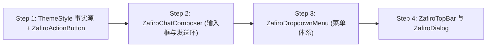

# Zafiro 主题架构演进实施计划：三模基建（Liquid / MD3 / MD3E）与真实 Preview

> **文档性质**：主题实现专项规划与分步实施清单  
> **文档位置**：`docs/theme-m3/PLAN.md`  
> **当前状态**：待命（待用户审查批准后，按既定四步依次执行）  

---

## 一、 用户完整原话记录（Unaltered & Unabridged）

以下按对话时序完整收录用户在本轮方案调研与设计对齐中的全部原话输入，不做任何删减、缩略或摘要：

### 第 1 轮
> 看起来前期的业务层清理已经做完了，现在我们应该进一步聊一下这个 Material Theme 的真正的实现。你觉得我们应该从哪里开始呢？我们现在是在一个方案调研阶段。

### 第 2 轮
> 先罗列一下有哪些是要细分的，因为有的组件，就比如说我们的主对话屏幕是不需要做 material 跟 liquid 的两种区分的，只有。呃，我罗列一下吧。只有标题栏，标题栏的左右两个按钮，标题栏的 drop down menu。还有我们的主对话页面的这个编辑框，编辑框的那个加号和发送按钮，还有设置页，呃，设置页倒没有，主要是对话框，dialog，对，应该就这几种，然后就没了。然后，我不知道我们切入点是什么，我觉得可以先把样子给确定下来。所以说，我看一下我们要不要先做一个 preview 呢？就我们重写一版 preview，专门是为了区分两种主题而做的 preview，就分别去横向对比两个 UI。就你一个文件里面，就写两个preview，这两个preview是对比，是同一个组件。然后我的设计哲学呢，就是现在的 action bar 和它两个按钮是在安卓十四加的版本，它就是呃 action bar 是模糊的，然后两个按钮是圆的嘛。那如果是在 material 里面，就应该是一个实心的背景，然后两个按钮是没有圆形。背景的，你应该懂传统的 Action Bar 是长什么样子，然后组对话界面的那个编辑框也是一样，加号和发送按钮都不应该有那个。圆圈就它，他们就是单独的两个按钮，或者我们后面再设计一下没问题。主要是我们把这个需求的依赖关系给搞清楚，是先做preview呢，还是先做组件？

### 第 3 轮
> 我的看法是，像 action bar 和一些 drop down menu 这些是属于。基建的东西，那就可以放在 U I Kit 里面。但是对于主对话界面这个编辑框，它很显然就是一个非常业务的东西，所以说它应该放在 App 模块里面。但是这样的话就会导致我们的代码有点散乱，就是这个模块里面又有一部分，另外一个模块里面又有一部分，这样我觉得不太好。你觉得呢？那我们就这么决定吧，先做 preview。但是在开始之前，我们先要决定，到底放在哪个包下面？你怎么判断呢？你怎么看？

### 第 4 轮
> 继续

### 第 5 轮
> 这个包可以再细化一点，不然后面可能又搞得像 ui/content 下面一样一堆东西了
> 
> 4个preview分四个文件，横向对比（每一个文件两个preview）
> 
> 现在开始吧，只做preview 不做别的，不改业务，我们直接在preview里面把样式调好了。liquid直接调原版，material在preview里面另起

### 第 6 轮
> /var/folders/py/t639_sts2z9dv5zdzwht_3700000gn/T/orca-paste-1792660834158-09fde26b-8741-4b00-a64f-03ea35eb9268.png ： 样式可以，但是liquid这个代码是不是写得有问题？
> 
> /var/folders/py/t639_sts2z9dv5zdzwht_3700000gn/T/orca-paste-1792660947928-b3eca2ad-5064-4f78-adbc-b2d837f088ff.png ： 这个还是稍微加一个深色的圆形背景吧，方便显示上下文占用的，你做得这版失真了
> 
> ---
> 
> 事实上我们应该分三类：
> 
> - liquid
> - MD3
> - MD3E
> 
> MD3和MD3E的区别：https://sspai.com/post/104595
> 
> 我不确定3和3E的代码是否可以同构，但他们的区别主要在形状、点击效果、颜色上面，还是说加个注解的事？（重点参考项目里面用到的loadingindicator）
> 
> ---
> 
> 我们聊聊，先别动

### 第 7 轮
> 我们的约束：
> 
> - 业务方感知不到自己用的究竟是liquid/md/mde，也就是说业务方一般来说不能自己管理颜色schema

### 第 8 轮
> 你现在任务我们应该继续打磨preview还是直接做正经基建（API样式对齐，复刻功能，但是这个比较重型）再接preview？？

### 第 9 轮
> 写一个PLAN.md 因为我们不可能一次做完这么多
> 
> 我们分四个大步，每次只做一个：
> 各个组件的3+3E以及Preview实现
> 
> 现在把我们的上下文，包括你对MD3/3E的理解，我的用户原话（不是概要，是原话）以及我们的计划全部写到文档，然后待命

---

## 二、 设计语言深度理解与技术对齐（MD3 vs MD3E vs Liquid）

参考用户提供的 SSPAI 分析文章（《告别无聊的圆角矩形：解读 Google 的全新设计语言 Material 3 Expressive》）及 Google I/O 2024 / Android 15+ 官方设计规范，结合本项目工程实际（`androidx.compose.material3:1.5.0-alpha22`），梳理三类设计语言的本质差异：

### 1. 三种风格核心特征矩阵

| 维度 | 1. Material 3 (MD3 / 经典 M3) | 2. Material 3 Expressive (MD3E) | 3. Liquid Glass (现行特效体系) |
| :--- | :--- | :--- | :--- |
| **设计核心** | 克制、稳重、低饱和度色板 | 活力、高功能引导性、视觉反差 | 仿生拟物、光学折射、毛玻璃沉浸 |
| **几何形状 (Shape)** | 规矩统一度极高的圆角矩形（16dp/28dp）与经典药丸 | **表现力几何体**（Squircle 平滑曲线、花瓣形、不对称几何） | 物理阻尼拖拽拉伸形变 |
| **动效与反馈 (Motion)** | 经典水波纹扩散（`ripple()`），线性透明度过渡 | **物理弹簧（Spring Physics）**、按压挤压（Squish 弹性缩放） | 弹性拖拽（`InteractiveHighlight`） |
| **色彩与对比 (Color)** | 柔和粉彩调和色板（Pastel Tonal），对比度偏平 | **高色彩反差**，突出主操作（如高对比实体圆形底盘） | 依赖背景折射光泽与半透明高光 |
| **渲染算力开销** | **零额外 GPU 消耗**（纯标准 Compose Canvas） | **零额外 GPU 消耗**（纯标准 Compose Canvas） | **高 GPU 消耗**（FBO 离屏抓取、RuntimeShader） |
| **代表性组件** | 标准 `IconButton`、`CircularProgressIndicator` | `LoadingIndicator` (多形态形变转圈)、`FilledIconButton` | `drawPlainBackdrop`、`applyLiquidInteractiveTransform` |

### 2. 关键技术洞见：Liquid 与 MD3E 的血缘关系
- **实质结论**：Zafiro 项目当前手搓的“液体交互”机制（如按压阻尼、拖拽微弹性、弹簧动画），**在物理动效层面天然契合 MD3E 的设计哲学**。
- 当前之所以存在性能瓶颈与视觉厚重感，是因为将“MD3E 的物理反馈”强行绑定在了“`com.kyant.backdrop` 毛玻璃折射与 AGSL Shader”这一重型渲染层上。
- **解耦价值**：将渲染层彻底剥离后，MD3E 可以完整保留弹簧与触感活力，同时拥有原生 Compose 零开销的运行性能。

### 3. 代码同构性与注解问题解答
- **“是加个注解的事吗？”**：
  **不是。** `@OptIn(ExperimentalMaterial3ExpressiveApi::class)` 仅是 Kotlin 编译期对实验性 API 的准入权限标记，用来使用官方新增的 Expressive 组件（如已引入的 `LoadingIndicator`）。它**不能**在运行时自动将普通组件转换为 Expressive 风格。
- **“3 与 3E 的代码是否可以同构？”**：
  **不仅可以同构，而且必须同构。**
  因为 MD3 与 MD3E 同属标准 Compose 渲染管线，两者的**布局结构、插槽（Slots）、业务状态流 100% 相同**。差异仅由参数化 Token 控制：
  1. **Shape Token**：MD3 采用纯圆角；MD3E 采用表现力曲线/Squircle。
  2. **Indication Token**：MD3 采用纯水波纹；MD3E 叠加 Spring 按压挤压缩放。
  3. **Elevation / Color Token**：MD3E 强化主次按钮对比度（例如在输入框中赋予 Send 按钮更醒目的高对比圆形底座）。

---

## 三、 核心架构约束与铁律

1. **业务方绝对零感知（Hard Gate）**：
   - 业务层（`app/` 模块的业务代码）绝对不能自己管理颜色 Schema。
   - 业务层绝对不出现 `if (theme == ThemeStyle.MD3)` 等分支判断。
   - 业务层始终面向统一的门面基件（`ZafiroActionButton`、`ZafiroChatComposer` 等）编程，所有主题切换逻辑由 `ui-kit` 与底层基件根据 CompositionLocal 自适应。
2. **拒绝孤立 Mock，真实 Preview 驱动（Zero Mock Drift）**：
   - 废除在 Preview 文件中手写“一套假 M3 代码”的开发方式。
   - Preview 必须直接调用生产组件，通过 `CompositionLocalProvider(LocalThemeStyle provides ...)` 注入环境。
   - 彻底避免由于缺少外层容器约束（如 TopBar 撑满全屏）或遗漏业务修饰（如发送键丢失进度环）导致的画面失真。
3. **性能硬熔断（Zero GPU Waste）**：
   - 当模式为 `Material3` 或 `Material3Expressive` 时，容器层直接短路跳过 `rememberLayerBackdrop()`、`.layerBackdrop()` 与 `RuntimeShader`，完全消除 FBO 离屏抓取。

---

## 四、 四大分步实施计划（各个组件的 3 + 3E 以及 Preview 实现）

按照“每次只攻坚一个大步、步步可验证”的原则，规划为以下四个阶段：



---

### Step 1: `ThemeStyle` 基础设施 + `ZafiroActionButton` 三模实装与真实 Preview
> **目标**：建立全局主题枚举，改造通用动作按钮，并在 Preview 中直观对比按钮在三种风格下的形态与交互。

- [x] **1.1 基础设施搭建**：
  - 在 `ui-kit/base/BaseTheme.kt` 中声明风格枚举：
    ```kotlin
    enum class ThemeStyle(val storageKey: String) {
        LiquidGlass("liquid"),
        Material3("md3"),
        Material3Expressive("md3e");
    }
    val LocalThemeStyle = staticCompositionLocalOf { ThemeStyle.Material3 }
    ```
- [x] **1.2 改造 `ZafiroActionButton` 内部实现**：
  - 读取 `LocalThemeStyle.current`。
  - **Liquid 态**：保留现行 `ActionBarButton`（带毛玻璃底盘与拖拽形变）。
  - **MD3 态**：标准实体圆底（`surfaceContainerHighest`，原生 `ripple()` 水波纹）。
  - **MD3E 态**：在实体底盘基础之上，叠加轻触弹性微挤压（`Modifier.springSquish` 弹簧动画与轻微触感），兼具活力与轻量。
- [x] **1.3 刷新 `TopBarThemePreview.kt` 为真实调用**：
  - 清理手写的 Mock 布局，直接调用 `ZafiroTopBar` 与 `ZafiroActionButton`。
  - 分别输出 Liquid、MD3、MD3E 的三模横向对照 Preview。

---

### Step 2: `ZafiroChatComposer` 输入框底板与发送按钮（含进度环）三模实装与真实 Preview
> **目标**：彻底解决发送按钮“失真”问题，让上下文占用进度环完美贴合在底座上，实现输入框三模无缝自适应。

- [x] **2.1 修复发送按钮的圆形载体与上下文环**：
  - **MD3 态**：发送按钮采用高辨识度的深色/主题色圆形实体底座，使上下文占用进度环（Context Ring）能够紧贴圆周自然绘制；加号按钮保持统一的 `primary` 前景色。
  - **MD3E 态**：在实体圆座基础上赋予高对比主操作底盘，加载中启用 `LoadingIndicator`（四叶草/花瓣动态变相），并带有弹簧触感反馈。
  - **Liquid 态**：保持现行毛玻璃光泽底座 + 阻尼形变。
- [x] **2.2 输入框整体底板三模分流**：
  - MD3 / MD3E：切换为 `surfaceContainerHigh` 实体底色与 28dp 圆角平铺容器（`SolidTextField`），彻底关闭底层毛玻璃 Presets 与 Shader。
  - Liquid：保留毛玻璃胶囊卡片。
- [x] **2.3 刷新 `ChatComposerThemePreview.kt` 为真实调用**：
  - 使用生产级的 `ZafiroChatComposer`，在真实 Preview 中验证上下文进度环、加号、文本输入在三模下的视觉呈现。

---

### Step 3: `ZafiroDropdownMenu` 菜单体系三模实装与真实 Preview
> **目标**：将手搓 Popover 与官方标准 M3 / M3E 菜单彻底收编于基件内部。

- [x] **3.1 改造 `ZafiroDropdownMenu` 与 `ZafiroMenuItem`**：
  - 读取 `LocalThemeStyle.current`。
  - **Liquid 态**：继续调用现行 `LiquidPopover`（带毛玻璃背景与浮动弹簧）。
  - **MD3 态**：直接切流至 Compose 官方 `androidx.compose.material3.DropdownMenu`，统一按压动效（8% 透明度、G2 平滑角、ContextClick 触感），支持锚点保活与高度滚动限制。
  - **MD3E 态**：采用 M3E 表现力菜单容器（选中态胶囊高亮、高反差 `secondaryContainer` 配色）。
- [x] **3.2 刷新 `DropdownMenuThemePreview.kt` 为真实调用**：
  - 验证多选勾选、副标题展示在三种风格下的弹出和渲染一致性。

---

### Step 4: `ZafiroTopBar` 与 `ZafiroDialog` 三模实装与真实 Preview
> **目标**：补齐顶栏滚动过渡和弹窗对话框的规范实现，消除高度撑满全屏的异常，完成全部 6 大交互组件的三模闭环。

- [ ] **4.1 改造 `ZafiroTopBar` 容器布局与背景过渡**：
  - 为 `ZafiroTopBar` 补全自适应高度约束（解决 Preview 中标题纵向居中的问题）。
  - **Liquid 态**：滚动时呈现 Progressive Blur 渐变毛玻璃。
  - **MD3 / MD3E 态**：滚动时直接以平坦 `surfaceContainer` 纯色实体底过渡，关闭 AGSL Shader 离屏抓取。
- [ ] **4.2 改造 `ZafiroDialog` 与 `ZafiroConfirmationDialog`**：
  - **Liquid 态**：保留 `LiquidDialog` 悬浮光泽毛玻璃。
  - **MD3 态**：标准 M3 `AlertDialog`（28dp 巨圆角、`surfaceContainerHigh` 实体面板、右下角对齐 `TextButton`）。
  - **MD3E 态**：保留 M3 实体面板，但支持更富张力的进入弹跳动效与高对比主操作键。
- [ ] **4.3 刷新 `TopBarThemePreview.kt` 与 `DialogThemePreview.kt` 为真实调用**。

---

## 五、 当前状态与下一步

- **当前状态**：文档已编写完毕，工作区已准备就绪。
- **待命指令**：**严格处于待命状态，未进行任何代码修改**。等待用户确认审查本计划。
- **下一步触发**：用户批准后，即可启动 **Step 1**（定义 `ThemeStyle` 基础设施并对齐 `ZafiroActionButton`）。


# 六、其他视觉优化

slider、switch和编辑框也需要修改为对应的风格